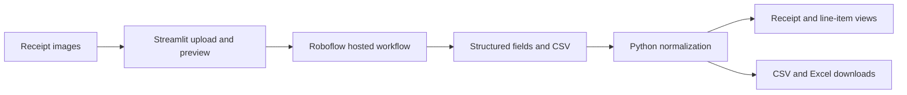

# Finance Bro
### Receipt photos in. Spreadsheet-ready expenses out.

[](https://www.python.org/)
[](https://streamlit.io/)
[](https://roboflow.com/)
[](#spreadsheet-output)

**Finance Bro turns receipt images into structured expense records you can inspect and export.** Upload a batch of receipts, extract merchant details and line items through a Roboflow workflow, review the results in a Streamlit dashboard, and download a CSV or Excel workbook.

Built as a hackathon prototype to address a practical problem: recording expenses should not mean retyping every receipt.

[Quick start](#quick-start) · [How it works](#how-it-works) · [Engineering decisions](#engineering-decisions) · [Limitations](#limitations-and-next-steps)

---

## The problem

A receipt contains useful financial information, but a photo alone is difficult to sort, search, or analyze. Transcribing merchant names, dates, totals, and individual products into a spreadsheet is repetitive work.

Finance Bro connects image-based extraction to an inspectable, portable output:

> **Upload → Extract → Review → Export**

The extraction runs through a hosted Roboflow workflow. The Python application handles the upload experience, response normalization, result presentation, and spreadsheet generation.

## What it does

| Capability | What the user gets |
| --- | --- |
| Batch receipt uploads | Upload multiple JPG, JPEG, PNG, or WEBP images and preview them before extraction. |
| Structured extraction | Retrieve merchant, date, subtotal, tax, total, currency, payment method, category, and line items when returned by the workflow. |
| Clear receipt view | Inspect key receipt details and a separate line-item table. |
| Spreadsheet export | Download combined receipt rows as CSV or an Excel workbook. |
| Source tracking | Associate output rows with the original filename and processing timestamp. |
| Response inspection | Inspect structured fields, parsed fallback results, and optional raw responses. |
| Per-file error handling | Display failures for individual files while continuing through the remaining batch. |

## How it works



1. **Upload:** Streamlit accepts images and displays a preview.
2. **Extract:** The app writes each upload to a temporary file and submits it to Roboflow using `InferenceHTTPClient.run_workflow()`.
3. **Normalize:** Python locates the expected output keys, parses JSON or CSV responses, and organizes the data into pandas DataFrames.
4. **Review:** Users inspect receipt details, line items, or diagnostic views.
5. **Export:** CSV and Excel files are generated in memory for download. Temporary image files are removed after each extraction attempt.

### Stack

| Layer | Technology |
| --- | --- |
| Application and UI | Python, Streamlit |
| Hosted receipt extraction | Roboflow Workflows, `inference-sdk` |
| Data parsing and transformation | pandas, Python JSON utilities |
| Excel generation | openpyxl via pandas |
| Runtime result state | Streamlit session state |

## Quick start

### Prerequisites

- Python **3.10 or newer**.
- A Roboflow API key with access to the configured receipt extraction workflow.
- An internet connection for hosted inference.

### 1. Clone and install

```bash
git clone https://github.com/Bilolini/finance_bro.git
cd finance_bro

python3 -m venv .venv
source .venv/bin/activate
python -m pip install -r requirements.txt
```

On Windows, activate the environment with:

```powershell
.venv\Scripts\Activate.ps1
```

### 2. Configure your API key

Choose one of these methods.

**Environment variable:**

```bash
export ROBOFLOW_API_KEY="your_roboflow_api_key"
```

**Streamlit secrets:** create `.streamlit/secrets.toml` with:

```toml
ROBOFLOW_API_KEY = "your_roboflow_api_key"
```

**In the app:** enter your key in the sidebar's password input.

The app checks the environment variable first, then Streamlit secrets. The secrets file is excluded from Git by the repository's `.gitignore`.

### 3. Start the app

```bash
python -m streamlit run app.py
```

Open **[http://localhost:8501](http://localhost:8501)**, or the local URL printed by Streamlit.

### 4. Process receipts

1. Upload one or more receipt images.
2. Check the image previews.
3. Click **Extract receipts**.
4. Review the **Clear view** and **Spreadsheet output** tabs.
5. Download **CSV** or **Excel**.

Google Sheets can import the downloaded CSV or Excel file. Excel can open the workbook directly.

## Workflow configuration

The application currently targets these values in `app.py`:

| Setting | Value |
| --- | --- |
| API endpoint | `https://serverless.roboflow.com` |
| Workspace | `bilols-workspace-wcafe` |
| Workflow | `text-recognition` |

To use your own workflow, update `WORKSPACE_NAME` and `WORKFLOW_ID`. It should return the following outputs:

| Output | Purpose |
| --- | --- |
| `receipt_fields` | Structured receipt data for the clear view and field export. |
| `receipt_csv` | CSV-compatible data for the spreadsheet view and combined export. |
| `model_output` | Optional raw model response for diagnostics and fallback parsing. |

The hosted workflow must be accessible to your API key. Its configuration is managed in Roboflow and is not provisioned by cloning this repository.

### Example structured result

Illustrative data; actual fields depend on the workflow and receipt quality.

```json
{
  "merchant": "Blue Bowl Cafe",
  "date": "2026-04-03",
  "subtotal": 16.50,
  "tax": 1.32,
  "total": 17.82,
  "currency": "USD",
  "payment_method": "credit",
  "category": "meals",
  "line_items": [
    {
      "description": "Rice bowl",
      "quantity": 1,
      "unit_price": 12.00,
      "total": 12.00
    },
    {
      "description": "Iced coffee",
      "quantity": 1,
      "unit_price": 4.50,
      "total": 4.50
    }
  ]
}
```

## Spreadsheet output

The main receipt column order is:

```text
merchant,date,subtotal,tax,total,currency,payment_method,category,line_items
```

The app adds `source_file` and `processed_at` so exported records can be traced back to their inputs. Additional returned fields are retained after the standard receipt columns.

- **CSV:** UTF-8 output suitable for importing into Google Sheets or Excel.
- **Excel:** An `.xlsx` workbook with a `Receipts` worksheet.
- **Line items:** Displayed as a table in the clear view and serialized into a single cell in the combined receipt export.
- **Fallback exports:** Separate field and fallback CSV downloads help inspect results when the main CSV output is unavailable.

## Engineering decisions

### Normalize at the model boundary

Hosted workflows can return nested objects, JSON strings, Markdown-fenced JSON, or lists of field/value records. The app handles these variations through focused parsing helpers before presenting the results.

`find_first_key()` searches nested output structures. `parse_jsonish()` handles JSON-like strings. `parse_receipt_fields()` and `parse_receipt_csv()` convert supported response shapes into DataFrames with a predictable column order.

### Keep results inspectable

Receipt summaries, extracted fields, parsed fallback data, and raw responses provide multiple ways to examine an extraction. This makes unexpected output easier to diagnose during a demo or workflow integration.

### Handle failures at the file level

Each receipt is processed inside its own error-handling block. A failed request is reported alongside its filename, and temporary files are cleaned up in a `finally` block.

### Keep the prototype straightforward to run

Streamlit provides uploads, tables, session state, and downloads in one Python application. Exports are generated in memory, so the app does not require a separate web frontend, API server, or export service.

## Repository guide

```text
finance_bro/
├── app.py                  # UI, workflow client, parsing, and exports
├── requirements.txt        # Python dependencies
├── .gitignore              # Local environments and secrets exclusions
└── README.md               # Setup and project documentation
```

Key entry points in `app.py`:

| Function | Responsibility |
| --- | --- |
| `call_roboflow()` | Submit an image and retrieve workflow outputs. |
| `parse_receipt_fields()` | Normalize structured receipt records. |
| `parse_receipt_csv()` | Parse spreadsheet-compatible responses. |
| `show_receipt_view()` | Present receipt details and line items. |
| `dataframe_to_excel_bytes()` | Generate the downloadable Excel workbook. |

## Limitations and next steps

This repository contains a functional prototype. Extraction quality depends on image legibility and the hosted workflow; users should review financial values before using the exported data.

Current boundaries:

- Results are held in Streamlit session state; there is no persistent receipt database in this version.
- Images are sent to the configured Roboflow service for processing.
- Batch requests are processed sequentially.
- Currency codes are extracted, but amounts are not converted between currencies.
- Google Sheets integration is through file import.
- This repository does not include a trained model, an automated test suite, or an extraction accuracy benchmark.

Potential extensions include SQLite persistence and duplicate detection, budget tracking, category and time-series analytics, configurable currency conversion, and direct Google Sheets synchronization.

---

Built by **[Bilolini](https://github.com/Bilolini)**.
